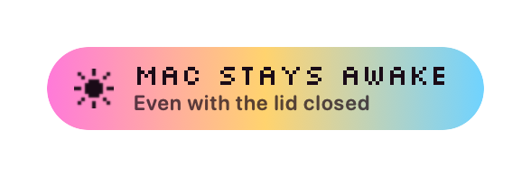
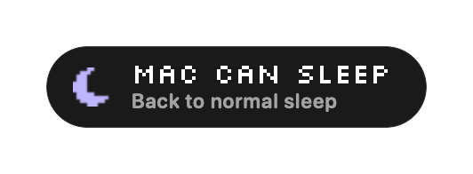

<p align="center">
  
</p>

<h1 align="center">Wham</h1>

<p align="center">
  <b>Close the lid. Your Mac stays awake.</b><br>
  A one-click menu bar switch that keeps your Mac awake, for real, even with the lid shut.<br>
  <a href="https://wham.sh">wham.sh</a>
</p>

<p align="center">
  
  
</p>

## What for

Anything that should keep running after you close the lid:

- **AI agents in the terminal.** Claude Code, Codex, OpenCode or Grok finish
  the task while you are away.
- **Video exports and renders.** Final Cut, Premiere, DaVinci Resolve, ffmpeg,
  Blender.
- **Local AI.** Ollama or LM Studio serving your other devices, big model
  downloads, fine-tunes.
- **Builds, tests, downloads, backups and syncs.**
- **Remote access.** A dev server you open from your phone, SSH, tmux, Screen
  Sharing.
- **A home server, 24/7.** An old Mac on a shelf, lid shut, up day and night:
  Plex, Home Assistant or Homebridge for the smart home, reachable from
  anywhere.

Scripts and agents can flip it too: `wham run make` keeps the Mac awake while
the job runs, `wham on 2h` for two hours.

## Install

**[Download Wham](https://wham.sh/download)**, open it and drag Wham into
Applications. Open Wham and click its switch in the menu bar. That is all: no
Terminal, no settings.

From a terminal, if you prefer:

| | |
| --- | --- |
| Script | `curl -fsSL wham.sh \| sh` |
| Homebrew | `brew install gwendall/tap/wham` |
| npm | `npx wham.sh` |

Wham needs macOS 11 Big Sur or later, on Apple silicon or Intel. Every way
installs the same signed and notarized app from the
[latest release](https://github.com/gwendall/wham/releases/latest), and from
then on Wham keeps itself up to date.

## Use it

Wham lives in your menu bar as a little switch.

- **Click it**: the sun comes up, the switch turns candy, and your Mac stays
  awake. Close the lid, unplug the screen: it keeps running.
- **Click again**: the moon comes back and your Mac sleeps as usual.
- **Right-click** (or control-click) for the menu: turn on for 1, 2, 4 or 8
  hours (each says when it would end), sound, appearance, open at login, stay
  on after restart, automatic updates, the battery limit, what's new, check for
  updates, quit. The menu stays open while you pick options: a click outside
  closes it. Each option answers with a little sound, as the switch does: up
  when it checks, down when it unchecks, a tick for a value picked (Sound, in
  the menu, turns them all off).

A timed session shows what is left: the menu says until when and how long, the
switch's candy drains toward the knob, and a note drops down five minutes
before the end. Stay Awake For gives it a new length, No Time Limit drops the
end (off, it turns Wham on with no end; checked while there is none).

Appearance, in the menu, fits it in with the icons around it: **Monochrome**
draws it in your menu bar's own ink, no color, and **Compact** keeps only the
knob, as wide as an icon, turning where it is instead of sliding; a timed
session runs out around it. Either one changes over half a second, colors and
width, at your display's pace.

Wham speaks your Mac's language: English, French, Spanish, German, Italian,
Portuguese, Japanese, Korean or Chinese. To give it another language than your
Mac's: System Settings > General > Language & Region > Applications. The `wham`
command and the journal stay in English.

The first time you turn it on, macOS asks for your password, once, and says
why (see [how it works](#how-it-works)). Quitting Wham always gives sleep back,
and so does a restart: with **Stay On After Restart**, in the menu, Wham turns
back on when you log in again (a timed session keeps its end).

Wham also lets go on its own, and the menu says why:

- **Time is up**, when you turned it on for a while.
- **On battery, at 10%**, or at 5, 20 or 30% (Battery Limit, in the menu). Your
  Mac sleeps with your work saved instead of running flat, and Wham will not
  turn back on until you plug in. Battery Limit: **Never** keeps it awake until
  the battery runs out: save your work first.
- **Your Mac gets critically hot.** Wham is for desks, docks and shelves, where
  air moves; in a closed bag an awake Mac has nowhere to put its heat. Turn it
  off before you pack up.

With the lid closed and no other display, Wham turns the built-in screen off,
which also locks your Mac as your Lock Screen settings say. And if Wham ever
goes away while on (a crash, a force quit), sleep comes back within a second.

From a terminal, the installer also gives you a `wham` command:

```sh
wham on          # your Mac stays awake, lid closed too
wham on 2h       # for two hours (45m, 1h30m, 1d...), then it sleeps as usual
wham off         # your Mac sleeps as usual
wham run make    # awake while make runs, then as it was before
wham toggle
wham status
wham log         # what Wham did and saw lately (wham log 200: more)
```

`wham run` exits with its command's status and passes Ctrl-C to it. Killed
itself, it still gives sleep back.

Wham keeps a journal, to tell afterwards what happened: when it turned on and
off and why, the lid, sleep and wake, the battery and the heat, and while on,
whether the network stayed up (and the Wi-Fi link's strength) with the lid
closed. `wham log` prints its last lines; it is in `~/Library/Logs/Wham`, which
Console opens too. It never leaves your Mac and names no one: no network name,
no address, no user or Mac name, and of a `wham run` command only the program.
Two files of 256 KB at most, the older one dropped.

## How it works

Keeping a Mac awake with the lid open is easy: apps like `caffeinate` or
Amphetamine hold a *power assertion*. But when you close the lid, macOS ignores
power assertions and sleeps anyway, unless an external display, keyboard and
power adapter are plugged in.

The one switch macOS does honor with the lid closed is the kernel's
`SleepDisabled` flag, set by:

```sh
sudo pmset -a disablesleep 1   # on
sudo pmset -a disablesleep 0   # off
```

That is all Wham does. To flip it without asking for your password every time,
Wham installs one sudoers rule, the first time, with your permission:

```
# /private/etc/sudoers.d/wham
#501 ALL=(root) NOPASSWD: /usr/bin/pmset -a disablesleep 0, /usr/bin/pmset -a disablesleep 1
```

It allows exactly those two commands, for your user (named by its ID, here
501, so any user name works), and nothing else. Wham checks the rule with
`visudo` before installing it.

The switch always shows what the kernel says, read from the IORegistry every
two seconds, never a cached guess. If something else flips the flag (`wham on`
in a terminal, `pmset`, a reboot), the switch follows. The battery, the heat
and the lid come from macOS as events, when they change.

While on, Wham keeps a watchdog: a tiny shell, waiting on a pipe that only Wham
writes to. However Wham ends, macOS closes the pipe, and the shell runs the
rule's own `pmset -a disablesleep 0`. When Wham turns off or quits, it tells
the watchdog to stand down. `wham run` keeps one too.

## Is it safe?

- About 3,100 lines of Swift, no dependencies, no analytics.
- One network request, a few times a day: Wham asks GitHub which release is
  the latest, and the request carries nothing about you or your Mac. When there
  is a newer one, Wham downloads it, checks that it is signed by the same
  developer and that it runs, and swaps it in; on stays on through the update.
  **Check for Updates** in the menu asks right away, and says how it went
  right there, without closing the menu. **Update Automatically**
  turns the swap off: Wham then only offers the new version in its menu.
  What changed in each one is in [CHANGELOG.md](CHANGELOG.md) and on
  [wham.sh/changelog](https://wham.sh/changelog).
- Every release is built from this repo, signed with Developer ID
  (`NQCA86NEA3`) and notarized by Apple. The `curl` installer and the updater
  both refuse an app signed by anyone else.
- The only privilege Wham holds is the rule above. Uninstalling removes it.
- The journal (see [Use it](#use-it)) stays on your Mac, readable by you
  alone, and holds nothing that names you, your Mac or your network.

## Tiny

One timer reads one kernel flag every two seconds. While on, Wham also listens
for the battery, the heat, the lid and the network, which macOS announces, and
writes a journal line when one of them changes.

| | Wham |
| --- | --- |
| App on disk | 2.5 MB (1.6 MB of it the universal binary) |
| Download | 3.2 MB (DMG), 1.4 MB (zip) |
| Memory | 10 MB |
| Idle CPU | about 0.03 % of one core (0.01 s every 30 s) |
| Dependencies | none |

For scale: KeepingYouAwake takes 7.6 MB on disk, and Amphetamine is a 6.7 MB
download before its helper apps.
[docs/compatibility.md](docs/compatibility.md) has the measurements, the
budgets CI holds it to, and every Mac setup we know of that could get in the
way (old macOS versions, standard accounts, managed Macs, a full menu bar) with
what Wham does about each.

## Compared with other apps

Closing the lid, on battery, with no display plugged in:

| | Lid closed | Size |
| --- | --- | --- |
| **Wham** | **Yes, on its own.** Download, drag, click; for as long as you say, and down to a flat battery only if you ask; macOS 11 or later, Intel too, notarized | 2.5 MB on disk |
| [Amphetamine](https://apps.apple.com/us/app/amphetamine/id937984704) | With helper apps: Amphetamine Enhancer from outside the App Store, and Power Protect on Apple silicon laptops | 6.7 MB download, plus helpers |
| [Caffeine](https://intelliscapesolutions.com/apps/caffeine) | No: it holds a power assertion, which macOS drops when the lid closes | 0.8 MB on disk |
| [KeepingYouAwake](https://github.com/newmarcel/KeepingYouAwake#readme) | No: it "will only prevent sleep on desktop Macs and portable Macs with an open lid" | 7.6 MB on disk |
| `caffeinate` | No: power assertions, and `-s` is "valid only when system is running on AC power" (`man caffeinate`) | built in |

Checked on 2026-10-12 against each app's own store listing, README or man
page, or its binary.

## Why not the Mac App Store?

Apps from the Mac App Store run in a sandbox, which cannot run `pmset` as root
or install a sudoers rule. A sandboxed app can only hold power assertions, and
macOS drops those when the lid closes. So any App Store "stay awake" app sleeps
with the lid shut; Wham cannot be one of them and still work.

## Uninstall

```sh
curl -fsSL wham.sh/uninstall | sh
```

This quits Wham (your Mac sleeps as usual again), removes the app, the `wham`
command, its settings, its journal and the sudoers rule (that last step asks for your
password). With Homebrew: `brew uninstall --zap wham`. With npm:
`npx wham.sh uninstall`.

## Build from source

You need the Xcode command line tools (`xcode-select --install`).

```sh
scripts/test.sh     # chime, sudoers rule and its install, sessions, watchdog, sprites, CLI, words in each language, shell scripts
scripts/build.sh    # build/Wham.app, universal, signed ad hoc without a Developer ID
scripts/eval.sh     # runs the app for real: budgets, and every switch, session, guard and exit on the real flag
open build/Wham.app
```

| Path | What |
| --- | --- |
| `app/Sources` | The app: menu bar switch, toast, chime, `pmset` and sudoers, updates, CLI |
| `app/Resources` | The icon, the pixel font, and the app's words in each language (`<language>.lproj/Localizable.strings`, the English text as the key) |
| `install.sh`, `uninstall.sh` | What `curl wham.sh` and `curl wham.sh/uninstall` run |
| `scripts/release.sh` | Tags a release; GitHub Actions (`release.yml`) runs `scripts/package.sh`, publishes it and updates the cask |
| `packaging/wham.rb` | The Homebrew cask template |
| `npm` | The `wham.sh` npm package |
| `CHANGELOG.md` | What changed for the people who use Wham, made from the changelog on [wham.sh](https://wham.sh/changelog) |
| `docs/brand.md` | Name, voice, colors, type, sprites, sound |

The website, [wham.sh](https://wham.sh), is built from its own repo. It serves
`install.sh`, `uninstall.sh` and the Silkscreen font from this one, and is
rebuilt when one of them changes on main (`.github/workflows/site.yml`).

To release, write what changed on the website's changelog, in every language:
it makes CHANGELOG.md here. Merge that, then run `scripts/release.sh 1.2.0`
from a clean main: it
checks the changelog has the version, tags and pushes, and the release workflow
builds, signs, notarizes, publishes with that version's notes and updates the
Homebrew cask. The npm package only wraps the installer, which always fetches
the latest release, so it is published by hand (`cd npm && npm publish`) only
when the wrapper or the scripts change.

`scripts/eval.sh` flips the kernel's real flag where sudo needs no password
(CI, or a Mac with Wham's rule), and puts it back as it was.
`scripts/lid-test.sh` checks the real thing: run it, close the lid for two
minutes, open it, and it tells you whether the Mac slept, whether the screen
went dark and whether it locked.
`scripts/update-test.sh` updates a 1.0.99 copy to 9.9.9 from a local stand-in
for GitHub, checks that a copy signed by someone else is refused, that with
Update Automatically off the menu offers the new version and installs it on a
click, and what Check for Updates says when there is nothing new or no answer
(it needs the Developer ID certificate). `scripts/eval.sh` clicks the menu's
options as a mouse would and checks that it stays open, that only a click
outside closes it, and that its rows look like the menu's own; with
`WHAM_SHOTS=dir`, it saves a picture of the menu at each step, and of the menu
and every kind of note in German, Japanese and French, which CI keeps for each
macOS it runs. The evals and the tests run the app in English
(`-AppleLanguages '(en)'`); to see it in another language, open it with
`open build/Wham.app --args -AppleLanguages '(ja)'`.
`scripts/sheet.sh` draws the switch in each of its looks, on a light and a dark
menu bar, into `build/sheet.png` (`--film` for it turning on, frame by frame,
`--looks` for each change of look).

## Credits

Made by [Gwendall](https://gwendall.com).

The pixel letters are [Silkscreen](https://github.com/googlefonts/silkscreen)
by Jason Kottke, under the SIL Open Font License 1.1
([app/Resources/OFL.txt](app/Resources/OFL.txt)).

Close the lid and go. Your Mac won't need waking up.

## License

[MIT](LICENSE)
